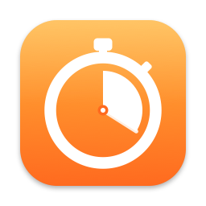
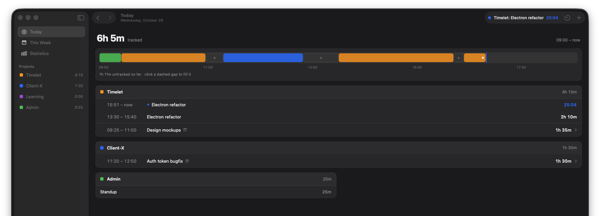
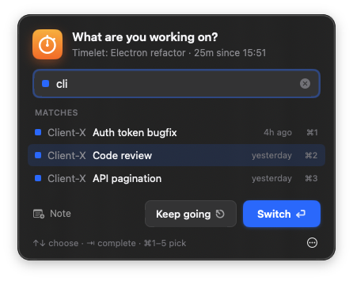
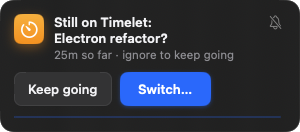

<div align="center">
  
  <h1>Timelet</h1>
  <p><strong>A time tracker that asks instead of making you remember.</strong><br>
  Every few minutes Timelet checks in — “What are you working on?” — and keeps time silently in between.</p>
</div>

<p align="center"></p>

Native **SwiftUI + SwiftData**, macOS 14+, local-only: no account, no server, no tracking.

## How it works

- **Answer once, it keeps counting.** Type `Project: what you're doing` (or pick a recent task) and Timelet times it until you switch.
- **It checks in gently.** At your interval, a small card appears in the corner: *Still on Timelet: Electron refactor?* It never takes the keyboard, so you can't type into it by accident. Ignore it and the task keeps running; click **Switch…** to change.
- **Or check in yourself** from anywhere with **⌃⌥T** (configurable).
- **It notices when you're away.** Idle time, sleep and a locked screen are cut out of the running task. When you come back, it asks what you were doing: lunch, a meeting, or nothing worth logging.
- **It never invents time.** If Timelet was quit or crashed mid-task, the task ends when the app was last running, not when you reopen it.

<p align="center">
  
  &nbsp;&nbsp;
  
</p>

## The check-in

The check-in is built to be answered in under two seconds without touching the mouse.

| | |
| --- | --- |
| **⏎** on an empty field | Keep the current task (or resume the last one) |
| Type, then **⏎** | Start that task. A hint shows exactly what will start, and flags a new project |
| **↑ ↓**, **⇥** | Choose a suggestion, or complete it into the field to edit it |
| **⌘1 … ⌘5** | Pick one of the recent tasks shown |
| **⎋** or click away | Keep going |
| **⌘N** | Add a note to the entry |
| `… 20m ago`, `… since 14:30`, `… @9:15` | Start the task in the past; the previous task ends at that moment |
| ⋯ menu | Pause, stop, done for today, or don't ask for a while |

Suggestions are ranked: whole-label prefix, then activity prefix, then word prefix, then substring, then letters in order (`tlelec` finds *Timelet: Electron refactor*), ties broken by most recently used. A suggestion is only picked by ⏎ when what you typed is clearly its beginning, so a new task name never silently becomes an old one.

## Everything else

| | |
| --- | --- |
| **Today** | Total, the day as a timeline (click a dashed gap to fill it), and one card per project. The running task is shown live |
| **Week / Statistics** | Day-by-day list for any week, and charts by day and by project |
| **Add time** | **⌘N**. One field understands `45m`, `1h30`, `9-10:30`, `2pm to 3:15pm`; it shows the exact interval, and warns about overlaps or future times |
| **Edit** | Click any block. Autocomplete for the task, ±5/15 min nudges, *Track again*, delete (with **Undo**) |
| **Menu bar** | Timer, task and timer, today's total, or icon only. The popover shows today's total, the next check-in, and switches to a recent task in one click |
| **Work hours** | Days and hours when check-ins happen. **Done for today** stops and stays quiet until the next working day |
| **Rounding** | Round reported durations to 1–30 minutes. Recorded times are never changed, so switching it off is lossless |
| **Export** | **⇧⌘E**: CSV for today, this/last week, this/last month, or everything |
| **Dock** | Optional: run from the menu bar only |

### Shortcuts

| Global (any app, configurable in Settings › Shortcuts) | |
| --- | --- |
| Check in / close the check-in | ⌃⌥T |
| Pause / resume | ⌃⌥P |

| In Timelet | |
| --- | --- |
| Check in · Add time · Pause/resume · Stop | ⌘K · ⌘N · ⇧⌘P · ⌘. |
| Today · Week · Statistics | ⌘1 · ⌘2 · ⌘3 |
| Previous / next day · Go to today | ⌘[ · ⌘] · ⌘T |
| Export CSV | ⇧⌘E |

The previous default, ⌘⇧T, took over "reopen closed tab" in every browser; the recorder warns about combos like that.

## Build & run

Requires macOS 14+, Xcode 16+ and [XcodeGen](https://github.com/yonaskolb/XcodeGen) (`brew install xcodegen`). The `.xcodeproj` is generated, not committed.

```bash
xcodegen generate
open Timelet.xcodeproj   # ⌘R
```

Or from the command line:

```bash
xcodegen generate
xcodebuild -project Timelet.xcodeproj -scheme Timelet -derivedDataPath build build
xcodebuild -project Timelet.xcodeproj -scheme Timelet -derivedDataPath build test
```

Data lives in `~/Library/Application Support/Timelet/Timelet.store` (Settings › Data › Show in Finder). Early builds used SwiftData's shared `default.store`; it is adopted on first launch only if it really contains Timelet's tables.

### Trying it with demo data

```bash
TIMELET_DATA_DIR=/tmp/timelet-demo TIMELET_SAMPLE=1 \
  build/Build/Products/Debug/Timelet.app/Contents/MacOS/Timelet
```

`TIMELET_DATA_DIR` keeps the demo away from your real data; `TIMELET_SAMPLE=1` seeds a week of believable entries.

## Releases (CI/CD)

Two GitHub Actions workflows, both on `macos-15` runners:

| Workflow | Trigger | What it does |
| --- | --- | --- |
| [`ci.yml`](.github/workflows/ci.yml) | push to `main`, PRs, manual | Debug build — "does it still compile" |
| [`release.yml`](.github/workflows/release.yml) | push of a `v*` tag, manual | Release build → universal `.app` → zip → GitHub Release |

Cut a release by pushing a tag; the version is taken from the tag name (`v1.2.3` → `MARKETING_VERSION=1.2.3`,
with the run number as the build number):

```bash
git tag v1.2.3
git push origin v1.2.3
```

Or, without tagging locally: **Actions → Release → Run workflow**, enter the version and tick
**publish** — `gh release create` creates the tag at that commit. Leaving **publish** unticked just
builds and uploads the artifact, which is handy for testing a change to the workflow itself.

The zip is attached to the [release](../../releases) and also kept as a workflow artifact for 30 days.
A version containing a hyphen (`v1.2.3-rc1`) is published as a pre-release.

### No Apple Developer account

There is no paid Apple Developer account behind this, so builds are **ad-hoc signed**
(`CODE_SIGN_IDENTITY = "-"`, i.e. "Sign to Run Locally") and **not notarized**. Practical consequences:

- Ad-hoc signing is not optional — arm64 binaries won't launch at all without at least an ad-hoc
  signature — so the workflow re-signs the finished bundle with `codesign --force --sign -`.
- The `.app` is zipped with `ditto`, not `zip`, so the bundle's symlinks and signature survive.
- Gatekeeper blocks the app on first launch, because the download carries a quarantine flag. Clear it:

  ```bash
  xattr -dr com.apple.quarantine /Applications/Timelet.app
  ```

  Or open it once, let it be blocked, then **System Settings → Privacy & Security → Open Anyway**.
  Each release body repeats these instructions.

Builds are universal (`ARCHS = "arm64 x86_64"`), so the same download runs on Apple Silicon and Intel.

> Note: this repo is private, and macOS runner minutes bill at 10× the Linux rate, so `ci.yml`
> deliberately skips branch pushes and doc-only changes.

## Architecture

The UI talks to tracking only through the `TrackingStore` protocol, so a networked/sync backend can
replace the local `TrackingEngine` later without touching views.

```
Timelet/
├── TimeletApp.swift          # @main: scenes (window · menu bar · settings), commands, store location, global shortcuts
├── Models/                   # SwiftData @Model: Project · Activity · Entry  (+ SampleData)
├── Store/TrackingStore.swift # TrackingStore + TrackingEngine: tracking, check-in schedule, away time, launch recovery
├── Settings/                 # AppSettings (UserDefaults-backed @Observable) · LoginItem (SMAppService)
├── Design/Theme.swift        # color / radius tokens from the handoff (light + tuned dark)
├── Support/                  # parsers (entries, durations, ranges) · Ranking · GlobalHotkey (Carbon) · IdleMonitor · Exporter
└── Views/
    ├── Main/                 # NavigationSplitView: Sidebar · DayView (timeline) · WeekView · StatisticsView · Add/Edit sheets
    ├── CheckIn/              # FloatingPanel · CheckInController · CheckInPanel · NudgeView (gentle reminder)
    ├── MenuBar/              # MenuBarExtra label + popover
    └── Settings/             # General · Shortcuts (recorder) · Projects
TimeletTests/                 # parsing, ranking, and TrackingEngine with an in-memory store and a fake clock
scripts/brand.swift           # draws the app icon at every size + brand/logo.svg
```

`TrackingEngine` takes an injectable clock and idle-time source, so the tests can walk through a day (switches, backdating, idle, sleep, quitting mid-task, the ask schedule) in milliseconds. The test scheme runs the host app with `TIMELET_IN_MEMORY=1`, so tests never touch real data.

## Dev hooks

All dev-only, all driven by environment variables:

| Variable | Effect |
| --- | --- |
| `TIMELET_DATA_DIR=/path` | Use another data folder |
| `TIMELET_IN_MEMORY=1` | Don't persist anything |
| `TIMELET_SAMPLE=1` | Seed demo data into an empty store |
| `TIMELET_SHOW=checkin\|nudge\|away\|add` | Open that UI at launch |
| `TIMELET_SCRIPT="show:checkin;type:elec;key:down;key:return;log:a"` | Drive the real UI with key events posted to Timelet's own windows (no Accessibility permission needed) and print the engine state after `log` steps |
| `TIMELET_SNAPSHOT=1 TIMELET_SNAPSHOT_DIR=/tmp/shots` | Render every screen to PNG with `ImageRenderer`, then quit |

